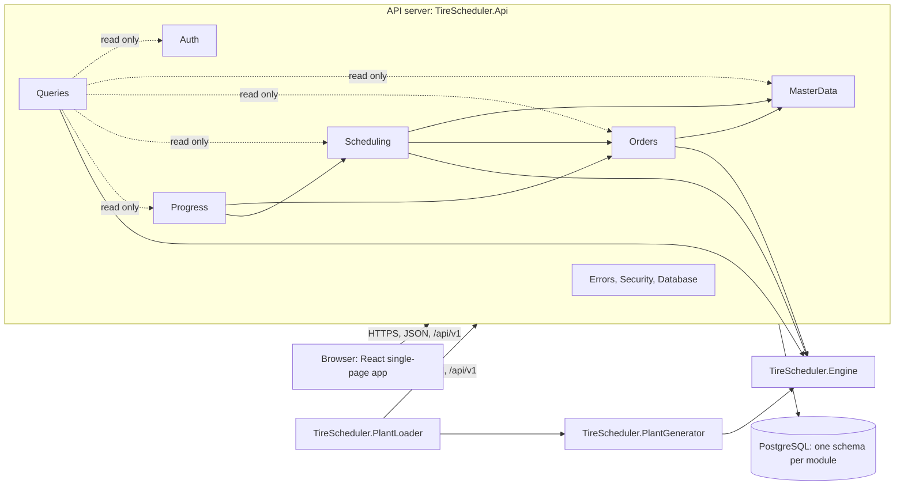
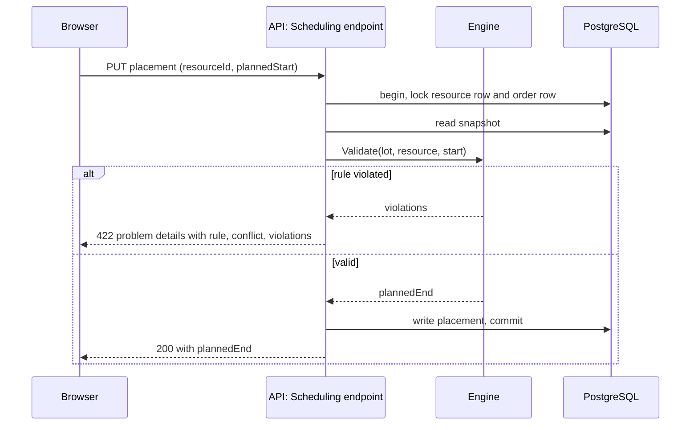
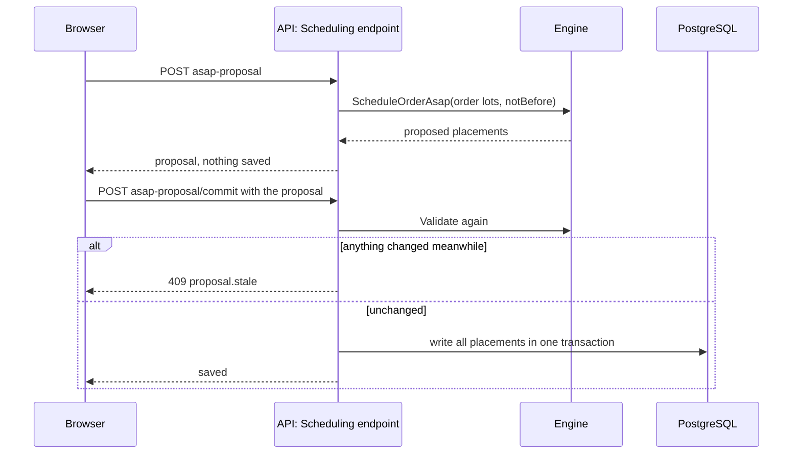
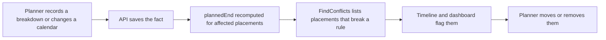

# Architecture

How the code is divided, the rules it must follow, how data moves through it while it runs, and where new code goes. It never holds setup, configuration, API reference, test details, history or plans.

## Structure

One deployable API, one single-page app and one PostgreSQL database. The API is one project with a folder (and namespace) per module, each with a public interface and an internal implementation (DEC-23). The scheduling engine is a separate project. The synthetic plant generator is two more projects outside the API: a pure core and a loader that writes through the API (DEC-32). The stack is in [README.md](README.md).

| Part | Owns | May depend on |
|---|---|---|
| Frontend (`frontend/src`) | Screens, forms, one fetch wrapper, generated API types | The API only |
| Auth | User, roles | none |
| MasterData | ResourceType, Resource, Calendar, CalendarShift, Holiday, Product, RoutingStage, RoutingDependency, plant time zone setting | none |
| Orders | Order, Operation, OperationDependency, Lot | MasterData (routing at order creation), Engine (lot duration, DEC-28) |
| Scheduling | ScheduleVersion, Placement, Unavailability; calls the engine | MasterData (resources, calendars), Orders (lots, dependencies), Engine |
| Progress | LotProgress | Orders, Scheduling (a lot must be placed in the live version before it starts) |
| Queries | Read models only, including all derived statuses and `isLate`; serves the order reads (DEC-29) and the machine reads (DEC-39) | All modules, read-only; Engine (late flag, DEC-30) |
| Engine | Scheduling rules and search over plain values | Nothing |
| Plant generator (`TireScheduler.PlantGenerator`) | Parameters, presets and a seeded synthetic plant as plain values | Engine (lot duration) |
| Plant loader (`TireScheduler.PlantLoader`) | Writing a generated plant into a running API as an Admin | Plant generator; the API over HTTP only |
| Errors, Security, Database | What every module uses: problem details and request validation, roles and access policies and the anti-forgery check, the request's connection and transaction, module contexts, row locks and startup steps | Nothing |

## Design

Rules every part must follow, each with its reason.

### Module rules

- One API instance, one app, one database, no services. Reason: 2-5 planners and 15-25 machines do not justify more.
- Each module owns its tables, in its own database schema, and no module reads another module's tables. Reason: modules are used only through their public interface, which keeps them replaceable.
- Dependencies point downward in the parts table and never form a cycle. Reason: a convention the compiler cannot check, so an architecture test enforces it on every commit (DEC-23).
- Reading upward goes through ports (DEC-16). Orders, to change, cancel or delete an order, needs "is any lot placed in the live version?" (`ILotPlacements`, implemented by Scheduling) and "has any lot started?" (`ILotProgress`, implemented by Progress). MasterData, before deleting a product, resource type or resource, asks the modules above it which of their rows use it (`IProductReferences`, `IResourceTypeReferences`, implemented by Orders; `IResourceReferences`, implemented by Scheduling; A14). Scheduling, for R8, needs "is this lot completed?" (Progress). The lower module declares the interface; the higher module implements it and registers it in dependency injection. Reason: source-code dependencies still point downward. Keep these ports few and read-only. The one write port is `ILotPlacements.RemoveUnstartedAsync`, with which cancelling an order removes its placements in the same transaction (DEC-33).
- Statuses are derived, never stored, and computed in Queries (`domain-model.md` section 6). Reason: lot, operation and order status need placements (Scheduling) and progress (Progress), and no module may write another module's status.
- Each module registers its services with one extension method and maps its own endpoints with another, into the `/api/v1` group that `Program.cs` passes in; endpoints are minimal API route groups (DEC-25, DEC-35). Reason: one place per module that the startup code calls.
- Errors, Security and Database depend on no module. Reason: every module uses them.
- Records in the API project use named `required` properties, not positional parameters (DEC-34). Reason: two swapped values of the same type cannot compile, and a new field does not compile until every place that builds the record sets it.
- Package versions and analyzer exceptions follow CLAUDE.md Coding style guide.

### Engine rules

- The engine is a pure library: inputs are plain values, outputs are results or rule violations, and everything it needs is passed in. No database, web stack, module types or clock. Reason: it can be tested without a database.

### Time rules

Implements A2.

- The database stores `timestamptz` in UTC, and the API sends and receives UTC.
- The plant time zone is one IANA id in MasterData settings (`Plant:TimeZone`, required, checked at startup). Every calendar answer carries it, and the UI renders in the plant zone, not the browser zone. Reason: every planner sees the same wall clock.
- Calendar shift times and holiday dates are plant-local, and on the server only the engine converts between local and UTC, using the zone id passed in. The UI converts only to show times on the plant's wall clock and to send the times a planner types as UTC (DEC-40, A38).
- Working time is measured in elapsed real time. On a DST day a local time that does not exist is skipped and one that occurs twice counts both occurrences, so the 3x8h pattern yields 23 or 25 working hours that day. Engine tests include a spring-forward and a fall-back case.
- Dependency lag is elapsed real time and ignores calendars (A8).
- A due date is a plant-local date, due at the end of that local day (DEC-22).
- Server code never reads the system clock; it uses the injected `TimeProvider`. Reason: "now" must be testable (needed for `isLate`, display status, `notBefore` and lockout).

### Access rules

- The session is a cookie with ASP.NET Core Identity (DEC-21): HTTP-only, `Secure`, `SameSite=Lax`, same origin for API and app, no token in browser storage. Reason: with one app on one origin, cookies are simpler and safer than the JWT the legacy code used. SSO (F-AUTH-4) can later be an external login provider.
- Passwords are hashed by Identity.
- Every request compares the session with the user's row, so sign-out and deactivation end a session at once (DEC-26, A21). Lockout failures are counted on the injected clock (DEC-26).
- State-changing requests carry an anti-forgery token (protocol in [API.md](API.md)).
- Roles are Planner, Viewer and Admin (F-AUTH-2), enforced by authorization policies on endpoints: Viewer reads everything; Planner edits orders, placements, unavailabilities and lot progress; Admin has Planner rights plus master data (including calendars and routings) and users.
- The UI hides actions a role cannot use, using the permission flags of `GET /me`, so it holds no role rules; only the API check counts.
- The first Admin is created from configuration at startup when the user table is empty; with the settings missing then, startup fails with an error naming them. Reason: no credentials in the repository.

### Persistence rules

- EF Core migrations, one schema per module, each with its own context and migration history, applied at startup (DEC-24).
- All module contexts of a request share one connection. A command that needs a transaction begins it through `RequestTransaction`, never on its own context, and a module it calls joins that transaction (DEC-33). Reason: a command that changes rows of several modules, such as a placement or a cancel, commits or rolls back as one. A request therefore runs one query at a time.
- Rows are locked with `LockRowAsync` (`SELECT ... FOR UPDATE`), which names the table and key column from the EF model and works only inside a transaction. Reason: no hand-written table names that a migration could leave stale.
- Text that is unique without regard to case (A20) has a stored upper-case copy of the column, and the unique index is on the copy. A broken unique index is answered as 409 `conflict.duplicate`. Reason: two requests at once cannot both save the same value.
- Constraints back the domain rules where possible: unique `Product.code`, unique `(product, sequenceNo)`, routing duration values and lags within their ranges, unique `(version, lot)` on placements, positive quantities (A7).
- R2 is also guarded by a PostgreSQL exclusion constraint on placements over `(version, resource, tstzrange(plannedStart, plannedEnd))`; touching ranges are allowed (half-open ranges). Reason: a race between two requests cannot double-book a resource.
- A routing is replaced as a whole in one transaction that locks the product row. Reason: two saves of the same routing run one after the other. Its stages get new ids on every save; nothing outside the routing refers to them (A1, A24).
- R3 and R4 span tables, so no single constraint covers them. A placement command locks the resource row and the order row, builds the engine snapshot, validates and writes in one transaction; MasterData and Orders lock their own row when Scheduling calls them (DEC-33). An open-ended unavailability is stored without an end, which every overlap check reads as infinite (DEC-41).
- Later facts never delete placements (domain-model.md section 5, DEC-18). The fact is saved anyway (it is true), affected `plannedEnd` values are recomputed, and `FindConflicts` lists the placements that now break a rule.
- Soft-deleted orders are excluded by a global query filter (F-NFR-1), and the unique index on the order number leaves them out, so a deleted order frees its number (A25). Cancel is a state change, not a delete.
- An order is changed, cancelled or deleted in one transaction that locks its row first, like a placement command, so the checks on its lots and the change cannot interleave with a placement of those lots.
- Modules keep the ids of another module's rows without a foreign key (for example `Order.ProductId`), because a constraint would tie the schemas together. The delete check goes through the ports above instead.
- The live schedule version row is created by the migration that adds the schedule version table (task M3-4).
- Seed and demo data come from the plant generator and are written by the plant loader, a separate program that calls the API like any client, so the API never loads them on startup (DEC-32).

### Error and API rules

- Every version-dependent URL carries the schedule version (DEC-17, format in [API.md](API.md)). Reason: scenarios (P2) then need no URL change.
- Every error is problem details with a stable `code` (format in [API.md](API.md)). Scheduling rule violations are 422 and are rejected, never adjusted (R7).
- Module code rejects a request by throwing `ApiProblemException`; one handler writes every problem details answer (DEC-25).
- Request bodies are checked by the `/api/v1` group for every endpoint in it, never by a step on the endpoint (DEC-35). Reason: module code reads required fields with `Validated()`, which is safe only after the check, and a forgotten step would answer a missing field with a 500.

### Frontend rules

- The server decides conflicts and computes planned ends; the UI shows the returned values and errors and keeps no business rules. Server state comes through a query cache library.
- Query keys are defined in `src/api/queryKeys.ts`, and after every successful write the query client reads the cached queries again in one place; forms and pages refresh nothing themselves (DEC-36). Reason: a write changes data that other areas show, and a refresh list per form misses some of them silently.
- One fetch wrapper (`src/api/request.ts`) adds the anti-forgery token and turns every rejection into an error that carries the problem details. The UI uses its `code` for behavior and shows `detail` to the user; form fields show the messages of their field.
- Routes are split per module area.
- The UI passes `live` as the version everywhere, through one setting. Reason: a scenario switcher (P2) then changes one value.
- Generated types and endpoint functions in `src/api/generated` are never edited by hand (DEC-27). Pages call the API only through the endpoint functions, which `npm run generate:api` writes from the OpenAPI document with the method, URL and response type of each operation (DEC-37). Reason: a hand-written list let the method and the response type differ from the server.
- The timeline (F-SCH-2) is read-only in v1, so it can be a simple custom component. Drag-and-drop (P1) is when a Gantt library should be evaluated.

## Data flow

Place a lot. The server computes the end, and the engine and the database both guard the rules.

- The UI sends the resource and start through the fetch wrapper, which adds the anti-forgery token.
- Security checks the session, the role policy and the token.
- The Scheduling module opens one transaction and locks the resource row and the order row.
- It reads the version's snapshot (calendars, resources, unavailabilities, placements, lots, dependencies) from the owning modules through their public interfaces and passes it to the engine.
- The engine returns `plannedEnd` or every violated rule.
- A violation is thrown as `ApiProblemException` and answered as 422; nothing is saved.
- Otherwise the placement is written. The exclusion constraint on placements is the last guard against a concurrent double booking.

Schedule an order as soon as possible. Two steps, so the planner reviews before anything is saved.

- The planner asks for a proposal and the API returns it without saving.
- The UI shows the proposal on a timeline preview.
- On confirmation the UI sends the same proposal to the commit endpoint, which saves all of it or nothing.

Later facts. A breakdown or calendar change keeps the placements and flags them.

## Systems

### Scheduling engine

- Owner: `backend/src/TireScheduler.Engine`, called by the Scheduling module.
- Rules: Design, Engine rules.
- Detail: [engine README](backend/src/TireScheduler.Engine/README.md) for inputs, operations and the search; behavior in the scheduling rules and engine search parts of [acceptance-criteria.md](REQUIREMENTS/acceptance-criteria.md).

### API

- Owner: the modules' endpoint files, with `Errors/` for problem details.
- Rules: Design, Error and API rules.
- Detail: [API.md](API.md) and the generated [OpenAPI document](backend/openapi/tire-scheduler-v1.json).

### Time

- Owner: the engine converts local and UTC; MasterData holds the plant time zone; the injected `TimeProvider` supplies now.
- Rules: Design, Time rules.
- Detail: the Calculations part of [domain-model.md](REQUIREMENTS/domain-model.md) and the engine criteria in [acceptance-criteria.md](REQUIREMENTS/acceptance-criteria.md).

### Authentication

- Owner: the Auth module, with `Security/` for roles, policies and the anti-forgery check.
- Rules: Design, Access rules.
- Detail: the sign-in criteria in [acceptance-criteria.md](REQUIREMENTS/acceptance-criteria.md); settings in [GUIDE.md](GUIDE.md) section Configuration.

### Persistence

- Owner: each module for its schema and migrations; `Database/` for the request's connection and transaction, module contexts, row locks and startup steps.
- Rules: Design, Persistence rules.
- Detail: creating a migration in [GUIDE.md](GUIDE.md) Developer setup.

### Synthetic plant generator

- Owner: `backend/src/TireScheduler.PlantGenerator` (core) and `backend/src/TireScheduler.PlantLoader` (loader).
- Rules: the core is pure like the engine and draws every value from one seeded random sequence, so a seed names a plant; the loader writes only through `/api/v1`, only into an empty plant (A31), and stops at the first rejection.
- Detail: the specification in [TASKS.md](TASKS.md) section "M2-7 synthetic plant generator", behavior in `acceptance-criteria.md` section 6, running it in [GUIDE.md](GUIDE.md) section "Load a generated plant".

### Frontend

- Owner: `frontend/src`, one folder per area (`auth`, `orders`, `machines`, `calendar`, `products`, `routing`, `shell`, `forms`, `api`).
- Rules: Design, Frontend rules.
- Detail: screens in [wireframes.md](REQUIREMENTS/wireframes.md).

## Extending

| Adding | Goes in |
|---|---|
| A module | Folder `backend/src/TireScheduler.Api/Modules/<Name>` with its `<Name>Module.cs` (service registration and endpoint mapping), called from `Program.cs`; its own DbContext, schema and `Migrations`; a row in the Structure parts table; `AllModules` and `AllowedDependencies` in `ModuleDependencyTests`; a route area in [API.md](API.md) |
| An endpoint | The module's endpoints and contracts files, mapped inside the `/api/v1` group the module is given (DEC-35); a role from `Security/AccessPolicies.cs`; acceptance criteria and API tests; then regenerate the OpenAPI document and the frontend types and endpoint functions (CLAUDE.md VERIFICATION TOOLS) |
| A database table or column | The module's entity and DbContext, then a migration under `Modules/<Module>/Migrations` (GUIDE.md Developer setup); constraints in the same migration |
| A scheduling rule or engine operation | `backend/src/TireScheduler.Engine` and its README; the rule in [domain-model.md](REQUIREMENTS/domain-model.md); acceptance criteria in the rules or engine search parts of [acceptance-criteria.md](REQUIREMENTS/acceptance-criteria.md); Engine tests |
| A problem code | `Errors/ProblemCodes.cs`; the criterion that expects it in [acceptance-criteria.md](REQUIREMENTS/acceptance-criteria.md) |
| A derived status or read view | `Queries/`; never a stored column |
| A read of a module above | A small read-only port declared in the lower module and implemented by the higher one (Design, Module rules); the table in Structure and `ModuleDependencyTests` stay unchanged |
| A role or access policy | `Security/UserRole.cs` and `Security/AccessPolicies.cs`; Design, Access rules |
| A startup step | An `IStartupStep` implementation in `Database/` or the owning module, registered in its module |
| A setting | `appsettings.json` and the Configuration table in [GUIDE.md](GUIDE.md) |
| A frontend screen | A folder under `frontend/src/<area>`, its route in `frontend/src/App.tsx`, its queries file, a test beside it; screen sketch in [wireframes.md](REQUIREMENTS/wireframes.md) |
| A test | By level in [TESTING.md](TESTING.md) |
| Generated data | A parameter in `PlantParameters` with its check in `PlantParameterChecks`, values in `PlantPresets`; a new kind of row also needs a write in the loader's `PlantWriter` through that row's endpoint |
| A later-version feature | [BACKLOG.md](REQUIREMENTS/BACKLOG.md), then a task in [TASKS.md](TASKS.md) |
