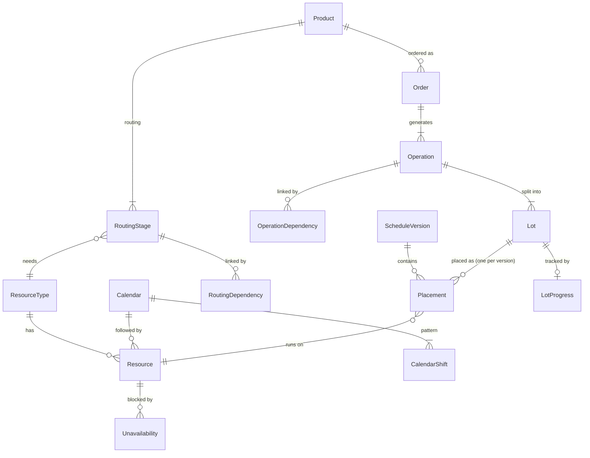

# Domain Model

Status: DRAFT. Covers v1 (P0 features) only. Source: [features.md](features.md), [README.md](../README.md). Items marked A# are assumptions; this file is their only list. Change them here first if the business answers differently. Open questions are in the Open table of [decisions.md](decisions.md).

## 1. Glossary

| Term | Meaning |
|---|---|
| Product | A tire model that can be ordered |
| Routing | The fixed set of stages a product goes through, with dependencies between them |
| Stage | One step in a routing, run on one resource type (for example Curing) |
| Dependency | A rule that one stage may start only a minimum lag after another stage ends |
| Resource type | A category of resource (extrusion line, building machine, curing press). In v1 every resource type is a machine type |
| Resource | A physical thing a lot occupies while it runs. In v1 always a machine |
| Calendar | A weekly shift pattern. Every resource follows one calendar |
| Working time | Time inside a resource's calendar, excluding plant holidays |
| Order | A customer request for a quantity of a product by a due date |
| Operation | The work for one stage of one order. An order has one operation per stage |
| Lot | A schedulable part of an operation, with its own quantity. An operation has one or more lots. The UI may call a lot a "job" |
| Schedule version | A complete set of placements. Exactly one is live; others are scenarios (P2) |
| Placement | A lot's assigned resource and start time within one schedule version |
| Unavailability | A period when a resource cannot run lots: planned maintenance or a breakdown |

## 2. Entities

### Master data (module MasterData)

| Entity | Attributes | Notes |
|---|---|---|
| ResourceType | id, name, kind | Kind is `Machine` in v1. Molds and crews (F-MAT-3) become new kinds later. Edited by Admin |
| Resource | id, name, resourceType, calendar, isActive | No status field. Displayed status is derived (section 6) |
| Calendar | id, name, isPlantDefault | Exactly one calendar in v1, the plant default (A3) |
| CalendarShift | calendar, weekday, startTime, endTime | One or more rows per weekday. Plant-local wall-clock time (A2) |
| Holiday | date, name | Non-working day for every calendar |
| Product | id, code, name, spec | Code is unique |
| RoutingStage | id, product, sequenceNo, resourceType, setupMinutes, cycleMinutes, unitsPerCycle | Unique (product, sequenceNo). Sequence starts at 1 and orders stages for display. Defaults: setupMinutes 0, unitsPerCycle 1 |
| RoutingDependency | product, predecessorStage, successorStage, minLagMinutes | No cycles. v1 UI generates a linear chain (stage N depends on N-1) with editable lag; the model allows parallel branches |

### Orders (module Orders)

| Entity | Attributes | Notes |
|---|---|---|
| Order | id, orderNo, customerName, product, quantity, dueDate, priority, createdAt, cancelledAt, isDeleted | Customer is plain text in v1 because the customer register is P1. Order number and priority as in A12. Soft delete (F-NFR-1, A13). Status is derived (section 6) |
| Operation | id, order, sequenceNo, resourceType, quantity, setupMinutes, cycleMinutes, unitsPerCycle | One per routing stage. Values copied from the routing, not referenced (A1) |
| OperationDependency | predecessorOperation, successorOperation, minLagMinutes | Copied from RoutingDependency at order creation (A1) |
| Lot | id, operation, lotNo, quantity, durationMinutes | Lot quantities of an operation add up to the operation quantity. v1 creates exactly one lot per operation (A6). `durationMinutes` is computed (section 4) |

### Scheduling (module Scheduling)

| Entity | Attributes | Notes |
|---|---|---|
| ScheduleVersion | id, name, kind, basedOn, createdBy, createdAt | Kind: Live or Scenario. v1 has exactly one Live version and no way to create scenarios (A10) |
| Placement | id, version, lot, resource, plannedStart, plannedEnd | Unique (version, lot). `plannedEnd` is computed, never typed in |
| Unavailability | id, resource, start, end, kind, reason | Kind: Planned or Breakdown. `end` may be empty for a breakdown with no known end. Shared by all versions (A9) |

### Progress (module Progress)

| Entity | Attributes | Notes |
|---|---|---|
| LotProgress | lot, actualStart, actualEnd | Recorded by the planner (F-PRG-1). Actuals are facts and belong to no version. The lot runs on its live placement's resource |

### Auth (module Auth)

| Entity | Attributes | Notes |
|---|---|---|
| User | id, name, email, role, isActive | Roles: Planner, Viewer, Admin |

## 3. Relationships

Key points:

- An operation needs a resource type; each placement picks a specific resource of that type (rule R1).
- Operations and their dependencies are copies. Editing a product's routing later does not change existing orders (A1).
- Every placement belongs to a schedule version. Rules are always checked within one version (section 5).

## 4. Calculations

Lot duration: calculated when the lot is created, from the operation's copied values:

`durationMinutes = setupMinutes + ceil(lot.quantity / unitsPerCycle) x cycleMinutes`

With the defaults (setup 0, one unit per cycle) this is `quantity x cycleMinutes`. Each lot pays its own setup. Sequence-dependent changeover (for example mold change between products, F-MD-7) is P1 and not included.

Worked example. Curing on a two-cavity press: setupMinutes 30, cycleMinutes 12, unitsPerCycle 2. Lot of 101 tires: `30 + ceil(101 / 2) x 12 = 30 + 51 x 12 = 642` minutes.

Planned end (R6): start at `plannedStart`, consume `durationMinutes` of working time from the placed resource's calendar, skipping non-working time. The result is `plannedEnd`.

Worked example. Calendar: Monday to Friday, 00:00-24:00 (three 8-hour shifts, A3). Lot duration 8 hours, start Friday 20:00.

- Friday 20:00-24:00 gives 4 hours of work.
- The weekend is non-working.
- Monday 00:00-04:00 gives the remaining 4 hours.
- `plannedEnd` = Monday 04:00.

Earliest start from dependencies (R4): for a successor lot, `max(predecessor lot plannedEnd + minLag)` over all placed lots of all predecessor operations. Lag is elapsed real time, not working time (A8).

## 5. Scheduling rules

All rules are checked among placements of one schedule version. Unavailability and progress are shared by all versions.

Rules are enforced when a placement is written. Facts recorded later (a breakdown, a calendar or holiday change) can make existing placements break R3 or R6. Those placements are kept and flagged as conflicts until the planner moves or removes them, never deleted or moved silently (`ARCHITECTURE.md` section 8).

| ID | Rule | Features |
|---|---|---|
| R1 | A lot can only be placed on an active resource of the type its operation needs | F-SCH-1 |
| R2 | No two placements on one resource overlap. Touching is allowed (one ends at 10:00, next starts at 10:00) | F-SCH-4 |
| R3 | A placement may not overlap an unavailability of its resource, of either kind. An unavailability with no end blocks everything from its start onward | F-MNT-1, F-SCH-4 |
| R4 | For every dependency, every placed successor lot starts no earlier than every placed predecessor lot's `plannedEnd` plus `minLag`. Lots can be placed in either order; an unplaced lot imposes no constraint until it is placed | F-SCH-5 |
| R5 | Retired. Machine status no longer blocks placements; a down or maintained resource is an unavailability under R3. The ID is kept so it is not reused | none |
| R6 | `plannedEnd` is computed from the resource's working time as in section 4. The start itself must fall inside working time | F-SCH-6 |
| R7 | Placement is rejected, not silently adjusted. The error names the rule broken and the conflicting item (placement, unavailability or lot) | F-NFR-2 |
| R8 | A lot that has started (In Progress or Completed) cannot be placed, moved or unplaced (A17). A lot of a cancelled order cannot be placed | F-ORD-2 |

Worked examples for every rule are acceptance criteria, in [acceptance-criteria.md](acceptance-criteria.md) section 4. That file is their only copy.

## 6. Lifecycles and derived status

Statuses are derived, never stored. A stored status could not be correct for every schedule version, and it would duplicate placements and progress.

Lot status (first matching row wins):

| Status | Condition |
|---|---|
| Cancelled | The order is cancelled and the lot has not started |
| Completed | Progress has `actualEnd` |
| In Progress | Progress has `actualStart` and no `actualEnd`. A start can only be recorded for a lot placed in the live version |
| Scheduled | The lot has a placement in the version being viewed (live by default) |
| Unscheduled | Otherwise |

Operation status follows the same rules over its lots: Completed when all lots are completed, In Progress when any lot has started, Scheduled when all lots are placed, Partly Scheduled when some are, otherwise Unscheduled. With one lot per operation (v1), Partly Scheduled does not occur.

Order status (F-ORD-2):

| Status | Condition |
|---|---|
| Cancelled | `cancelledAt` is set. Allowed only while no lot is In Progress |
| Completed | All lots completed |
| In Progress | At least one lot started, not all completed |
| Scheduled | At least one lot placed, none started |
| Pending | No lot placed |

Resource display status (replaces the stored machine status, F-MNT-2):

| Status | Condition at the current time |
|---|---|
| Down | A breakdown unavailability covers now |
| Maintenance | A planned unavailability covers now |
| Running | A lot on this resource is In Progress |
| Idle | Otherwise |

Marking a machine down means creating a breakdown unavailability starting now, with an estimated end if known. Bringing it back means setting the end.

Late is a flag, not a state (decided). An order can be Scheduled and late, or In Progress and late. It is computed at query time for a given version, never stored. Cancelled orders are never late. Due date ends at the end of its plant-local day (`ARCHITECTURE.md` section 5).

- Unfinished order: `isLate` when now is after the due date, or any lot's `plannedEnd` in the version is after it.
- Completed order: `isLate` when the last lot's `actualEnd` is after the due date.

The dashboard (F-RPT-1) counts it without a state clash. The order list needs a separate "late" filter. F-SCH-10, F-RPT-3 (P1) and the scenario comparison (F-SCH-12, P2) reuse it.

Order progress (F-PRG-2) = completed quantity / total quantity over the lots of all operations, so lots of different sizes count fairly. With one lot per operation it equals completed operations / total operations.

## 7. Assumptions

| ID | Assumption |
|---|---|
| A1 | Routing is fixed per product. Orders copy its stages, dependencies and duration values into operations at creation, so later routing edits do not affect existing orders. Per-order alteration can be added later without changing the copy approach. Editing an order's product or quantity is allowed only while none of its lots is placed in the live version or started; operations and lots are then regenerated |
| A2 | Times are stored in minutes-precision UTC and shown in one configured plant time zone. Calendar times are wall-clock time in that zone, so DST days are 23 or 25 hours long (BQ1). Planners pick starts on a 15-minute grid in the UI (UI-only, the model does not depend on it). `plannedEnd` is stored and recomputed when a calendar or the holidays change |
| A3 | One calendar in v1, the plant default: Monday to Friday, three 8-hour shifts. Holidays apply to every calendar. Every resource references a calendar, so per-resource calendars (F-MD-6, P1) are new data, not a schema change. A 24/7 plant is expressed as calendar rows. Until F-MD-6, weekend starts are rejected by R6 (BQ2) |
| A4 | Materials and molds are ignored in v1 (P2). Molds will be resources of a new kind |
| A5 | Only Planner and Admin edit; Viewer is read-only |
| A6 | A lot runs on one resource without interruption, except that it pauses across non-working time (weekends, holidays). It never runs across an unavailability: such a placement is rejected under R3. An operation can be split into several lots on different resources; v1 always creates one lot per operation, and manual splitting (F-ORD-7) is P1 |
| A7 | Order and lot quantities are positive whole numbers of tires |
| A8 | Dependency lag is elapsed real time, not working time, because the processes it models (resting, cooling) continue outside shifts |
| A9 | Unavailability is shared by all schedule versions because it is a fact about the plant, not a planning choice. Moving planned maintenance per scenario can be added later |
| A10 | v1 has exactly one live schedule version. Creating, comparing and committing scenarios is P2 (F-SCH-12). Every placement carries a version from v1 so scenarios need no schema change |
| A11 | A dependency links operations, so every successor lot waits for every predecessor lot. Overlapping stages lot by lot (transfer batches) can be added later as a dependency option |
| A12 | The planner types the order number (unique without regard to case), so it matches the numbers already used in spreadsheets. Priority is Low, Normal or High (default Normal) and only sorts and filters in v1 |
| A13 | Delete is for orders entered by mistake: allowed only while the order is Pending with no live placement and no progress, as a soft delete. Every other order is cancelled instead. Cancelling removes the placements of its lots that have not started, in every version, so they stop blocking machines |
| A14 | Master data that other rows reference cannot be deleted; a resource is retired by deactivating it. A resource with placements cannot change its type. Resource names and resource type names are unique |
| A15 | Deactivating a resource is always saved. Its placements stay and are flagged as R1 conflicts, as for other later facts (DEC-18) |
| A16 | R3 overlap is checked over the whole span from `plannedStart` to `plannedEnd`, including non-working time in which the lot pauses. Planned maintenance on a weekend therefore blocks a lot that pauses over that weekend. To confirm with the business (BQ5) |
| A17 | A started lot stays where it is in the live version: it runs on that machine, and its actuals are recorded against that placement. Completed lots keep their placement as the record of where they ran |
| A18 | The plant time zone is set once in configuration and not editable in v1, because changing it would shift every calendar and stored local date. A shift never crosses midnight; a night shift across midnight is two rows |
| A19 | The order history in F-ORD-5 is the creation time and the cancellation time in v1. A full change history needs the audit trail (F-AUTH-5, P1) |
| A20 | Names and codes are stored without surrounding spaces. Resource names and resource type names are unique without regard to case, like the product code, so "Press 1" and "press 1" cannot both exist |
| A21 | Signing out ends every session of that user, on every device, because sessions are ended through the user and not one by one (DEC-26). A session ends after 12 hours without a request (setting) |
| A22 | Master data lists (resource types, resources, products) are returned whole, without paging, because a plant has tens of rows of each. Paging stays for lists that grow, such as orders |
| A23 | Text lengths: resource, resource type and calendar names up to 100 characters, product code up to 50, product name up to 200, product spec up to 500. The first Admin is created with the name "Administrator" |

## 8. Out of the model for v1

Customer entity, sequence-dependent changeover, machine-product eligibility, per-resource calendar exceptions and overtime, manual lot splitting, non-machine resources (molds, crews), scenario creation and commit, locks, audit trail, quantity produced and scrap, materials. Each is P1 or later. The model has a place for each: `Order.customerName` becomes a foreign key, `Resource.calendar` takes other calendars, `ResourceType.kind` takes new kinds, operations already hold 1..n lots, and placements already carry a version.
