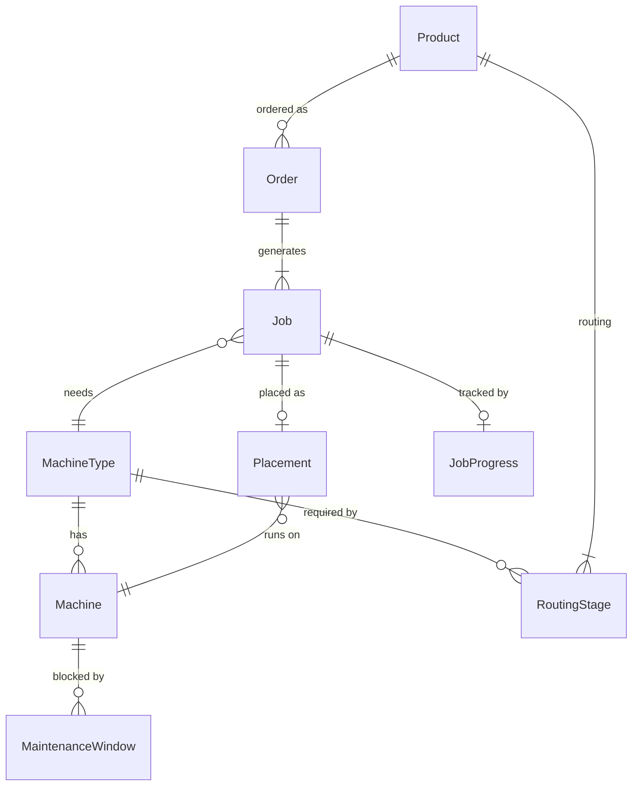

# Domain Model

Status: DRAFT. Covers v1 (P0 features) only. Source: [features.md](features.md), [business-problem.md](business-problem.md). Items marked **A#** are assumptions that resolve open questions in `features.md` section 5. Change them here first if the business answers differently.

## 1. Glossary

| Term | Meaning |
|---|---|
| Product | A tire model that can be ordered |
| Routing | The fixed, ordered list of stages a product goes through |
| Stage | One step in a routing, run on one machine type (for example Curing) |
| Machine type | A category of machine (extrusion line, building machine, molding press) |
| Machine | A physical machine of one type |
| Order | A customer request for a quantity of a product by a due date |
| Job | The work for one stage of one order. An order has one job per stage |
| Placement | A job's assigned machine and start time |
| Working time | Time inside the shift pattern, excluding holidays |
| Maintenance window | A planned period when a machine cannot run jobs |

## 2. Entities

### Master data (module MasterData)

| Entity | Attributes | Notes |
|---|---|---|
| MachineType | id, name | Fixed list, edited by Admin |
| Machine | id, name, machineType, status, isActive | Status: Running, Idle, Maintenance, Down |
| Product | id, code, name, spec | Code is unique |
| RoutingStage | id, product, sequenceNo, machineType, minutesPerUnit | Unique (product, sequenceNo). Sequence starts at 1 |
| ShiftPattern | weekday, startTime, endTime (one or more rows per weekday) | One plant-wide pattern in v1 (A3) |
| Holiday | date, name | Non-working day for the whole plant |

### Orders (module Orders)

| Entity | Attributes | Notes |
|---|---|---|
| Order | id, orderNo, customerName, product, quantity, dueDate, priority, status, isDeleted | Customer is a plain text field in v1 because the customer register is P1. Soft delete (F-NFR-1) |
| Job | id, order, sequenceNo, machineType, quantity, durationMinutes, status | Created from the routing when the order is created. Values copied, not referenced (A1) |

### Scheduling (module Scheduling)

| Entity | Attributes | Notes |
|---|---|---|
| Placement | job, machine, plannedStart, plannedEnd | One per job at most. `plannedEnd` is computed, never typed in |
| MaintenanceWindow | id, machine, start, end, reason | Blocks placements on its machine |

### Progress (module Progress)

| Entity | Attributes | Notes |
|---|---|---|
| JobProgress | job, actualStart, actualEnd | Recorded by the planner (F-PRG-1) |

### Auth (module Auth)

| Entity | Attributes | Notes |
|---|---|---|
| User | id, name, email, role, isActive | Roles: Planner, Viewer, Admin |

## 3. Relationships

Key points:
- A job needs a machine **type**; the placement picks a specific **machine** of that type (rule R1).
- `Job.machineType`, `quantity` and `durationMinutes` are copies. Editing a product's routing later does not change existing orders (A1).

## 4. Calculations

**Job duration:** `durationMinutes = quantity x routingStage.minutesPerUnit`, calculated at order creation. Setup time is P1 and not included.

**Planned end (R6):** start at `plannedStart`, consume `durationMinutes` of working time (shift pattern minus holidays), skipping non-working time. The result is `plannedEnd`.

Worked example. Pattern: Monday to Friday, 00:00-24:00 (three 8-hour shifts, A3). Job duration 8 hours, start Friday 20:00.
- Friday 20:00-24:00 gives 4 hours of work.
- The weekend is non-working.
- Monday 00:00-04:00 gives the remaining 4 hours.
- `plannedEnd` = Monday 04:00.

## 5. Scheduling rules

| ID | Rule | Features |
|---|---|---|
| R1 | A job can only be placed on an active machine of the type the job needs | F-SCH-1 |
| R2 | No two placements on one machine overlap. Touching is allowed (one ends at 10:00, next starts at 10:00) | F-SCH-4 |
| R3 | A placement may not overlap a maintenance window on its machine | F-MNT-2, F-SCH-4 |
| R4 | A job in stage N+1 may not start before the job in stage N of the same order ends. Both must be placed to check; if stage N is unplaced, stage N+1 cannot be placed | F-SCH-5 |
| R5 | A machine with status Maintenance or Down accepts no new placements | F-MNT-1 |
| R6 | `plannedEnd` is computed from working time as in section 4. The start itself must fall inside working time | F-SCH-6 |
| R7 | Placement is rejected, not silently adjusted. The error names the rule broken and the conflicting item | F-NFR-2 |
| R8 | A completed or cancelled job cannot be placed or moved | F-ORD-2 |

Worked examples (Press 1, pattern as in section 4):

| Case | Existing | Attempt | Result |
|---|---|---|---|
| R2 overlap | Job A, Mon 08:00-12:00 | Job B starts Mon 11:00 | Rejected, overlaps Job A |
| R2 adjacent | Job A, Mon 08:00-12:00 | Job B starts Mon 12:00 | Accepted |
| R3 | Maintenance Tue 06:00-10:00 | 4-hour job starts Tue 04:00 (ends 08:00) | Rejected, overlaps maintenance |
| R4 | Stage 1 ends Mon 10:00 | Stage 2 starts Mon 09:00 | Rejected, stage 1 not finished |
| R4 | Stage 1 ends Mon 10:00 | Stage 2 starts Mon 10:00 | Accepted |
| R6 | Holiday on Monday | 8-hour job starts Fri 20:00 | Ends Tue 04:00 |

Acceptance criteria for these rules are still to be written before M3.

## 6. Lifecycles

**Job status:** Unscheduled, Scheduled, In Progress, Completed, Cancelled.

| From | To | Trigger |
|---|---|---|
| Unscheduled | Scheduled | Placement created |
| Scheduled | Unscheduled | Placement removed |
| Scheduled | In Progress | Planner records actual start |
| In Progress | Completed | Planner records actual end |
| Unscheduled, Scheduled | Cancelled | Order cancelled |

**Order status** (F-ORD-2) is derived from its jobs, apart from Cancelled:

| Status | Condition |
|---|---|
| Pending | No job is placed |
| Scheduled | At least one job placed, none started |
| In Progress | At least one job started, not all completed |
| Completed | All jobs completed |
| Cancelled | Planner cancelled while no job is In Progress |

**Delayed is not a state (decided).** `features.md` lists it as one, but an order can be Scheduled and late, or In Progress and late. It is a derived flag, computed at query time, never stored. Cancelled orders are never late.
- Unfinished order: `isLate` when now is after `dueDate`, or any job's `plannedEnd` is after `dueDate`.
- Completed order: `isLate` when the last job's `actualEnd` is after `dueDate`.

The dashboard (F-RPT-1) counts it without a state clash. The order list needs a separate "late" filter. F-SCH-10 and F-RPT-3 (P1) reuse it.

Order progress (F-PRG-2) = completed jobs / total jobs.

## 7. Assumptions

| ID | Assumption | Resolves |
|---|---|---|
| A1 | Routing is fixed per product. Orders copy it into jobs at creation, so later routing edits do not affect existing orders. Per-order alteration can be added later without changing the copy approach. Editing an order's product or quantity is allowed only while none of its jobs is placed or started (jobs are then regenerated) | Q2 |
| A2 | Times are stored in minutes-precision UTC and shown in one configured plant time zone. The shift pattern is wall-clock time in that zone, so DST days are 23 or 25 hours long. Planners pick starts on a 15-minute grid in the UI (UI-only, the model does not depend on it). `plannedEnd` is stored and recomputed when the shift pattern or holidays change | Q3 |
| A3 | One plant-wide shift pattern: Monday to Friday, three 8-hour shifts, plus a holiday list. `ShiftPattern` is data, so a 24/7 plant can be expressed without code changes. Weekend overtime for single machines is handled later through a per-machine calendar (F-MD-6, P1); until then weekend starts are rejected by R6 | Q6 |
| A4 | Materials and molds are ignored (all P2) | Q4 |
| A5 | Only Planner and Admin edit; Viewer is read-only | Q5 |
| A6 | A job runs on one machine without being split. It may pause across non-working time (weekends, holidays) but never across a maintenance window: such a placement is rejected under R3 and the planner starts the job after the window. Pausing across maintenance may be revisited with per-machine calendars | none |
| A7 | Order quantity is a positive whole number of tires | none |

## 8. Out of the model for v1

Customer entity, setup times, machine-product eligibility, per-machine calendars, order splitting, locks, audit trail, quantity produced and scrap, materials. Each is P1 or later; the model leaves room to add them (for example `Order.customerName` becomes a foreign key).

## 9. Decisions and remaining questions

Decided (task P1): Delayed is a derived flag (section 6); A1 to A3 accepted with the additions above; A6 rejects placements across maintenance windows.

Still unanswered, assumed as written until the business says otherwise:
1. Does the plant's time zone observe DST (A2)?
2. Does the real plant run weekends (A3)? If so, seed seven days of `ShiftPattern` rows instead of five.
